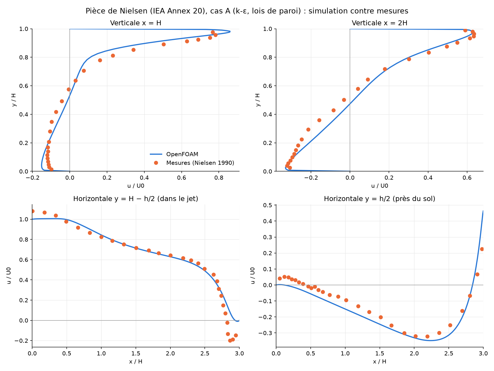
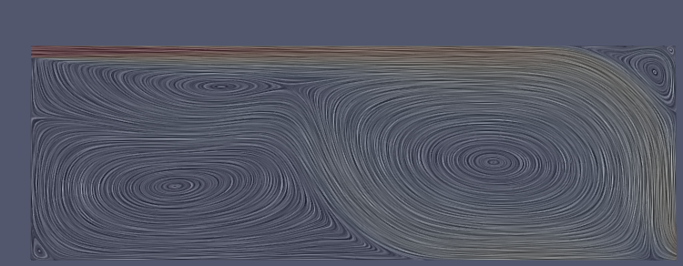
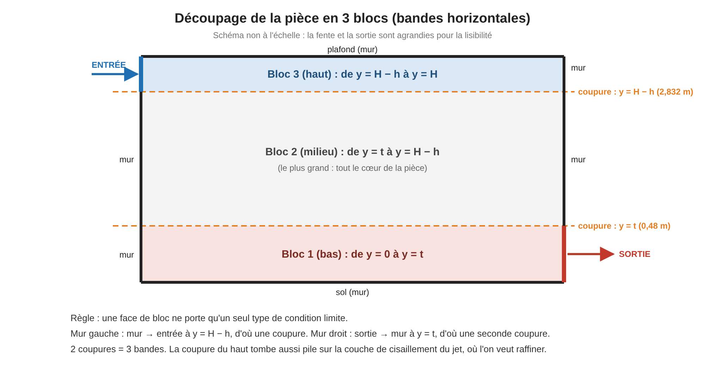
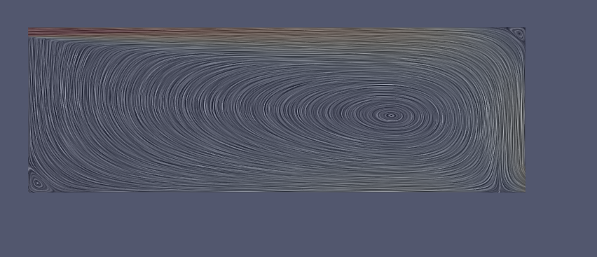

# Pièce ventilée de Nielsen (IEA Annex 20, cas 2D)

Validation d'une chaîne de calcul OpenFOAM pour la ventilation des bâtiments, sur le benchmark de
référence de l'IEA Annex 20 (Nielsen, 1990) : pièce de 9 m × 3 m, soufflage par une fente sous le
plafond, Re ≈ 5 100, mesures laser-Doppler.



## Géométrie et maillage



Maillage structuré généré en Python (classy_blocks), découpé en 3 blocs pour séparer les conditions limites :


| Maillage A : k-ε, lois de paroi (7 986 mailles) | Maillage B : k-ω SST, y+ ≈ 1 (16 014 mailles) |
| --- | --- |
|  |  |

## Topologie de l'écoulement

| k-ε : une seule grande recirculation | k-ω SST : deux cellules contrarotatives |
| --- | --- |
|  |  |

## Résultats

| Ligne de mesure | k-ε + lois de paroi (écart moyen) | k-ω SST, y+ ≈ 1 (écart moyen) |
| --- | --- | --- |
| Verticale x = H | 5,3 % | 15,6 % |
| Verticale x = 2H | 3,0 % | 5,2 % |
| Jet (y = H − h/2) | 6,6 % | 11,4 % |
| Sol (y = h/2) | 4,8 % | 10,9 % |

Écarts en % de la vitesse de soufflage U₀.

- **k-ε standard** : reproduit la grande recirculation unique mesurée ; sous-estime la taille des
  tourbillons de coin.
- **k-ω SST** (y+ < 5 partout, solution convergée) : prédit deux cellules contrarotatives absentes
  des mesures. Le modèle le plus récent n'est pas le meilleur sur ce cas.
- **Convergence en maillage** (3 maillages, 4 000 à 16 000 mailles) : GCI de 1,8 % sur la vitesse
  max du jet et 2,7 % sur la vitesse de retour au sol. L'erreur restante vient du modèle de
  turbulence, pas du maillage.

## Reproduire les calculs

Prérequis : OpenFOAM 13 (openfoam.org), Python 3 avec `pip install classy_blocks foamlib pyvista matplotlib`.

```bash
# Cas A : k-epsilon + lois de paroi (≈ 30 s)
python3 maillage_nielsen.py A cas_kepsilon
cd cas_kepsilon && ./Allrun && python3 validation_nielsen.py && cd ..

# Cas B : k-omega SST, couche limite résolue
python3 maillage_nielsen.py B cas_komegaSST
cd cas_komegaSST && ./Allrun && cd ..

# Comparaison des deux modèles avec les mesures
python3 comparaison_AB.py

# Étude de convergence en maillage (3 calculs pilotés par foamlib)
python3 etude_maillage.py
```

## Contenu

| Fichier | Rôle |
| --- | --- |
| `maillage_nielsen.py` | Maillage classy_blocks (3 blocs), versions A et B, facteur de raffinement |
| `cas_kepsilon/`, `cas_komegaSST/` | Cas OpenFOAM (conditions limites, schémas, solveur) |
| `profils_nielsen.py` | Convergence itérative : profils à plusieurs instants |
| `validation_nielsen.py` | Comparaison simulation / mesures sur les 4 lignes |
| `comparaison_AB.py` | Comparaison k-ε / k-ω SST / mesures |
| `etude_maillage.py` | Étude de convergence en maillage (foamlib + GCI de Celik) |
| `mesures_nielsen_*.csv` | Mesures laser-Doppler (Nielsen, 1990), hauteur ramenée depuis le sol |
| `figures/` | Graphiques produits par les scripts |

## Références

- Nielsen P. V. (1990), *Specification of a Two-Dimensional Test Case (IEA)*, Aalborg University.
- Mesures : [Aalborg University, 2D benchmark test](https://en.build.aau.dk/web/cfd-benchmarks/two-dimensional-benchmark-test).
- Celik I. B. et al. (2008), *Procedure for Estimation and Reporting of Uncertainty Due to
  Discretization in CFD Applications*, J. Fluids Eng. 130.

## Rapport complet

[Rapport d'étude (PDF, 12 pages)](rapport/rapport_piece_nielsen.pdf) : méthode, maillage, validation,
comparaison des modèles de turbulence, convergence en maillage, limites et perspectives.
